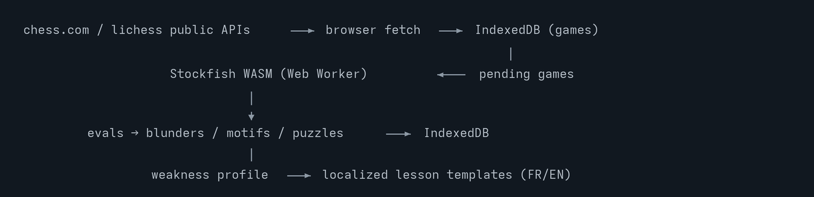
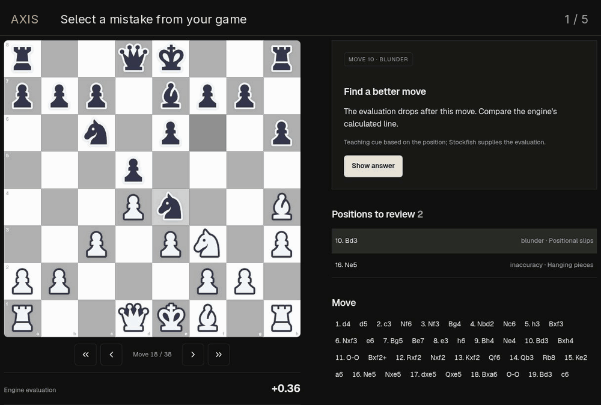

# AXIS

**Analyze. Understand. Improve.**

Adaptive eXplanation & Improvement System turns completed Chess.com, Lichess, and PGN games into browser-based Stockfish analysis, mistake review, personalized lessons, and spaced practice. No account or paid AI key is required. English and French supported.

## How it works



## Demo



[Static preview](public/media/axis-demo.png) · Recorded from a completed game, using the production build.

## Run it

```bash
npm ci
npm run dev
```

Open [localhost:3000](http://localhost:3000), enter your public username or import PGN, then choose a game to analyze. Try a correction before revealing the answer; return to Training for scheduled reviews.

## Features

- **Review:** legal move navigation, engine evaluations, mistake classifications, evaluation chart, and verified continuations.
- **Learn:** recurring weaknesses, lessons, exercises from your games, attempts, and reviews after 1, 3, 7, 14, and 30 days. Failed reviews restart at one day.
- **Customize:** board themes, language, analysis depth, sound, and optional AI coaching with your own provider key.

## Deploy and verify

Import this repository into Vercel using **main** and the Next.js preset. No environment variables are required; optionally set `NEXT_PUBLIC_SITE_URL` to your domain. Installation copies the Stockfish worker, WASM, and GPL license into public assets. Verify with `npm test`, `npm run lint`, `npm run typecheck`, and `npm run build`.

Progress is stored on this device in IndexedDB, with localStorage fallback. Clearing browser data removes it. Imports require network access; engine depth and device resources affect analysis. Coaching cues are heuristic and identified separately from engine calculations. Use completed games only.

## License

MIT, built on [Chess Coach by Leonel Ngoya](https://github.com/ln-dev7/chess-coach); see [LICENSE](LICENSE). Stockfish.js is GPL-3.0; its license and [corresponding source](https://github.com/nmrugg/stockfish.js/tree/32d4b5ae40c01db88219bfbe2b82dbe6dec93832) are linked from the app's Licenses page.
