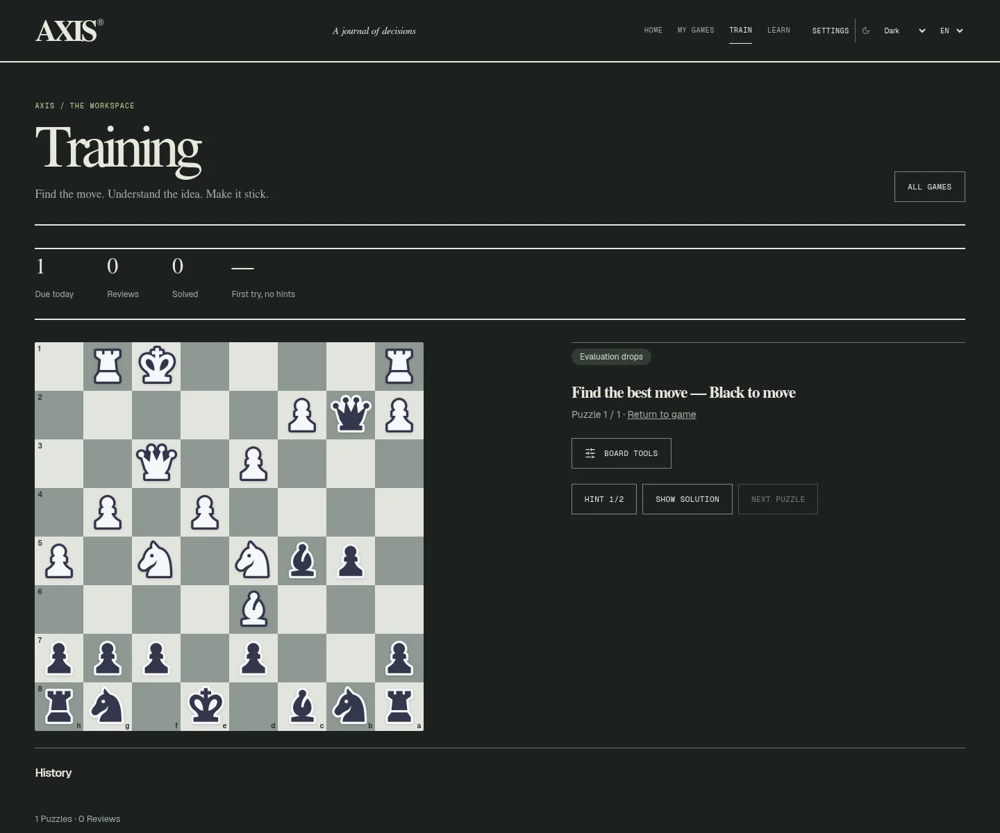
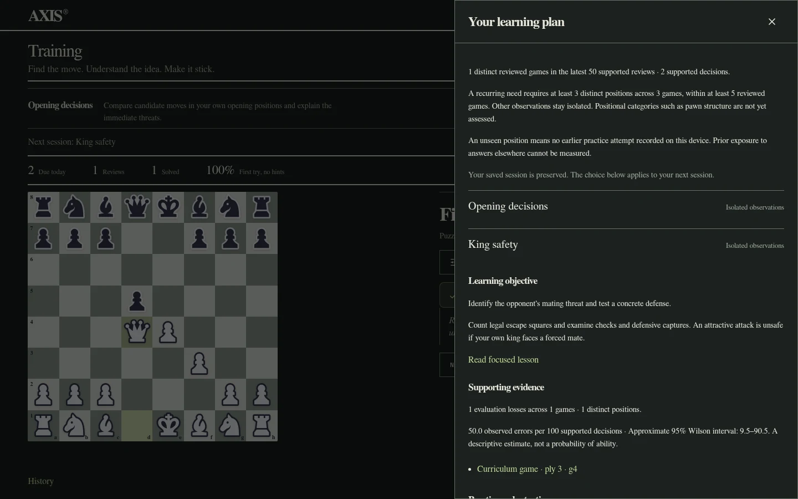

# AXIS

I’m building AXIS, a chess learning application that turns game review into focused practice.

[Open AXIS](https://axls.vercel.app/) · [V4 release notes](https://github.com/Iunacy/axis/releases/tag/v4.0.0)

In V4, I can build a learning plan from completed Stockfish 19 reviews. AXIS separates isolated mistakes from recurring needs, selects focused concepts and exercises from my games, and lets me choose another skill. Piece safety, tactical vision, forks, king safety, material calculation, opening decisions, endgame decisions, and conversion have explicit evidence rules. Optional related mating examples come from verified Lichess puzzles.

I can practice legal engine lines with progressive hints, resume a saved session, and track attempts, assistance, elapsed time, first-attempt success, and delayed retention. Reviews use a transparent spaced schedule. New game mistakes can reopen a skill without deleting my history. Reading a lesson or memorizing one position does not establish mastery.

I can import completed Chess.com, Lichess, and PGN games, review them automatically in a compact desktop workspace, and explore persistent legal variations. Ordinary analysis uses Stockfish 19 Lite; optional bounded deep analysis loads the full engine on request (about 95 MiB). Games and training stay on this device.

I keep the limits visible: engine searches and skill labels are heuristics; small histories remain inconclusive. Game comparisons require enough matching platform/time-control data and do not prove training caused improvement. Positional categories such as pawn structure are not yet assessed. My next milestone is to evaluate this curriculum against larger histories and broaden its evidence coverage.

[MIT license](LICENSE) · Built on [Chess Coach by Leonel Ngoya](https://github.com/ln-dev7/chess-coach). Stockfish.js is GPL-3.0; its license and corresponding source are linked in AXIS’s Licenses page.
