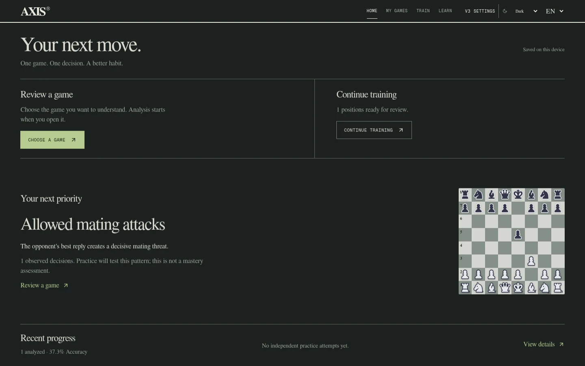
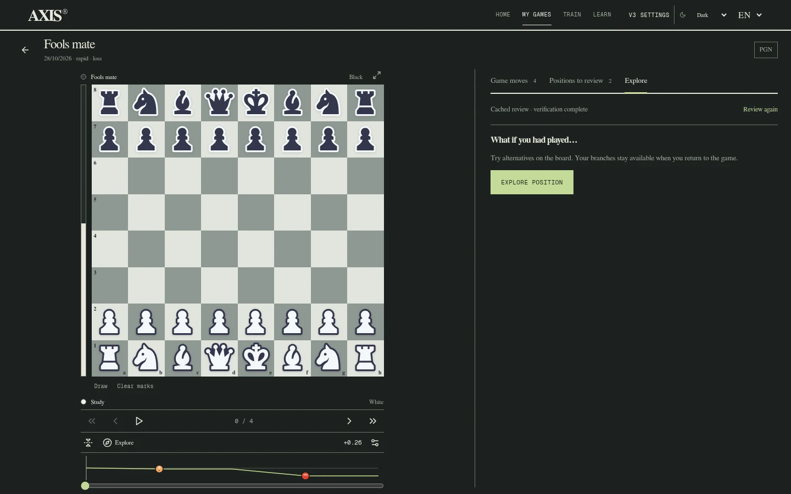

# AXIS

I’m building AXIS, a chess learning application that turns game review into focused practice.

[Open AXIS](https://axls.vercel.app/) · [V3 release notes](https://github.com/Iunacy/axis/releases/tag/v3.0.0)

In V3, I can choose a game from the dashboard, open an automatic Stockfish 19 Lite review, explore legal variations, and practice decisions from my games. The desktop workspace keeps navigation and the board in view, with contextual panels for game selection and performance history. Optional deep position analysis loads the full engine only when I request it (about 95 MiB), with bounded search effort and cancellation.

I can import completed Chess.com, Lichess, and PGN games. Reviews save progressively and resume after interruptions; engine caches distinguish the engine and search configuration. Lessons, verified mating patterns, and master games support further study. Games, settings, variations, and training history stay on this device.

My next milestone is an evidence-based adaptive curriculum: recurring weaknesses, targeted interactive exercises, retention, and honest progress comparisons. V3’s recommendations summarize observed mistakes; they do not measure mastery. Finite engine searches and AXIS’s classification heuristics can miss chess ideas.

[MIT license](LICENSE) · Built on [Chess Coach by Leonel Ngoya](https://github.com/ln-dev7/chess-coach). Stockfish.js is GPL-3.0; its license and corresponding source are linked in AXIS’s Licenses page.
