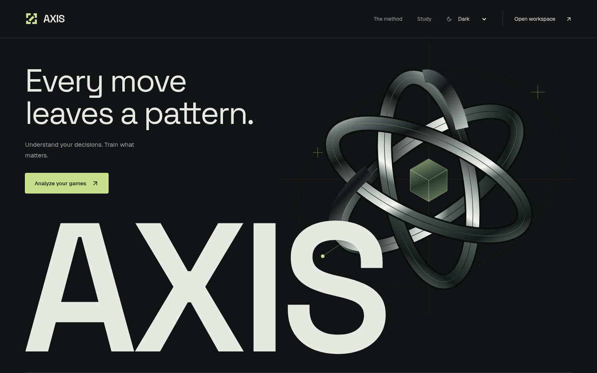
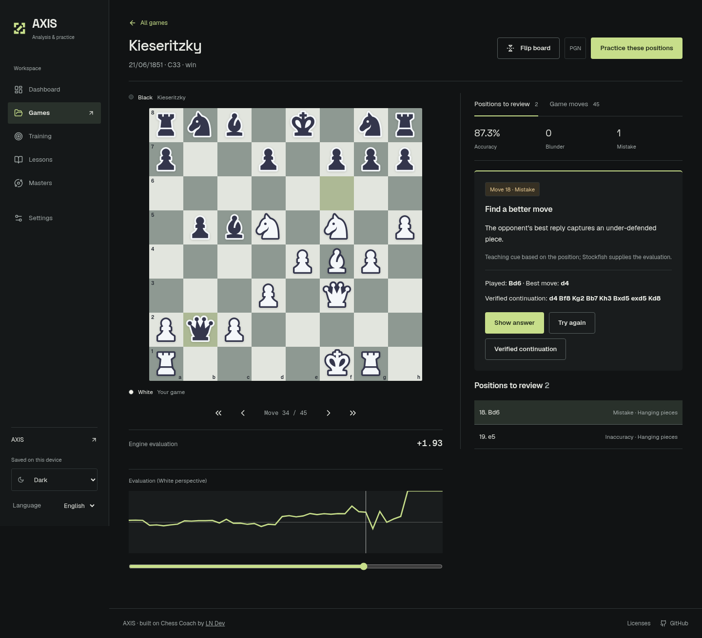

# AXIS

**Understand your decisions. Train what matters.**

AXIS — Adaptive eXplanation & Improvement System — turns your Chess.com, Lichess, and PGN games into local Stockfish analysis, focused mistake review, and personal training. Free, private, and available in English and French.

The direction is a precise, comfortable chess workspace: a clear view of the board, explanations grounded in your moves, and practice that returns to the patterns you miss. A cinematic public identity gives way to quiet analysis, with graphite and warm-paper themes throughout.

[Explore AXIS](https://axls.vercel.app) · [MIT license](LICENSE) · Built on [Chess Coach by Leonel Ngoya](https://github.com/ln-dev7/chess-coach). Stockfish.js is GPL-3.0; license and corresponding source are linked from the app’s Licenses page.
